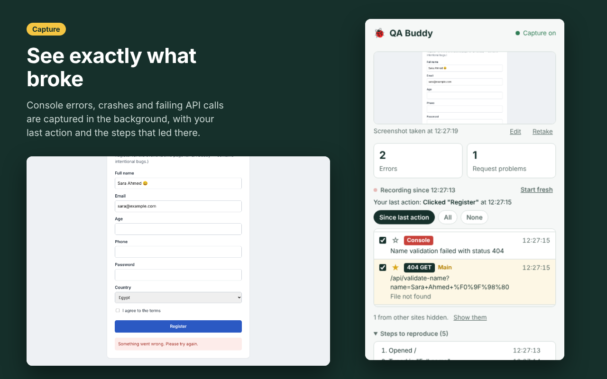

# 🐞 QA Buddy

**Capture bugs with console errors, failed requests, steps and a screenshot, and report them to Jira in a few clicks.**

QA Buddy is a Chrome extension that records what developers need to fix a bug, quietly in the background, and turns it into a complete Jira ticket.



## Features

**Capture**
- Console errors, uncaught errors and failed promises, with file, line and stack trace
- Request problems: failed, cancelled and slow `fetch`/XHR calls and failed page resources, including inside iframes
- Steps to reproduce: pages, clicks, selections and the fields you typed in (**never what you typed**)
- Screenshot with box, arrow and blur tools
- Environment: browser, OS, screen, window, language, time zone

**Focus on the bug**
- Only what happened after your **last action** is included by default
- Repeated calls to the same endpoint are grouped
- Noise from other sites (analytics, ads, widgets) is hidden
- Star the **main problem** so developers know where to start

**Report**
- **Jira**: create a new issue (project, issue type, assignee) or add the report to an existing one, after reviewing exactly what will be sent; the screenshot and HTML report are attached
- **Download** a self-contained HTML report, or **copy** the report as text

**Private by design**
- Data stays in the browser until you send it to your own Jira
- Passwords, tokens, API keys and typed values are masked
- Choose which sites QA Buddy runs on
- No analytics, no tracking, no servers. See the [privacy policy](https://ebrahemsamer2.github.io/qa-buddy/privacy-policy.html).

## Install

- **Chrome Web Store:** [Add QA Buddy to Chrome](https://chromewebstore.google.com/detail/qa-buddy/lhmdoibblkanbbcegbkhaabhdomgdhfp)
- **From source:** download this repository, open `chrome://extensions`, turn on **Developer mode**, click **Load unpacked** and select the `extension` folder.

## Set up Jira

1. Create an API token at [id.atlassian.com](https://id.atlassian.com) → Security → **Create API token** (the plain one, not "with scopes").
2. QA Buddy → **Settings**: your Jira site (`https://your-company.atlassian.net`), email and API token.
3. **Test connection** → **Save settings**.
4. Optional: **Sites to capture** → only your sites, to keep other tabs fast.

## Development

```
extension/        the Chrome extension (Manifest V3, no build step)
dev/demo/         demo page with intentional bugs + slow API server
dev/tools/        mock Jira server for testing without a real Jira
store/            Chrome Web Store listing texts, screenshots and promo tile
scripts/          packaging script
index.html        project homepage (GitHub Pages)
privacy-policy.html
```

1. Load `extension/` with **Load unpacked**. After code changes, click **reload ↻** on the extension card and reload the page.
2. Demo page: `python3 dev/demo/server.py` → http://localhost:8080
3. Mock Jira (testing only): `python3 dev/tools/mock-jira.py` → Jira site `http://localhost:8090`, token `test-token`, project `HACK`.

See [dev/README.md](dev/README.md) for details.

## Package for the Chrome Web Store

```bash
./scripts/package.sh
```

Creates `dist/qa-buddy-<version>.zip` with `manifest.json` at the top level. Listing texts and steps: [store/STORE_LISTING.md](store/STORE_LISTING.md).

## Permissions

| Permission | Why |
|---|---|
| `scripting` | Registers capture scripts on the sites you allow; reads page details when you open QA Buddy |
| `storage` | Settings (local) and captured data for the current tab (session) |
| `webRequest` | Detects failed page resources; requests are observed, never blocked or modified |
| `<all_urls>` | Capture on whichever site you test, take screenshots, and reach your own Jira site |

## License

[MIT](LICENSE) © 2026 Ebrahim Samir
